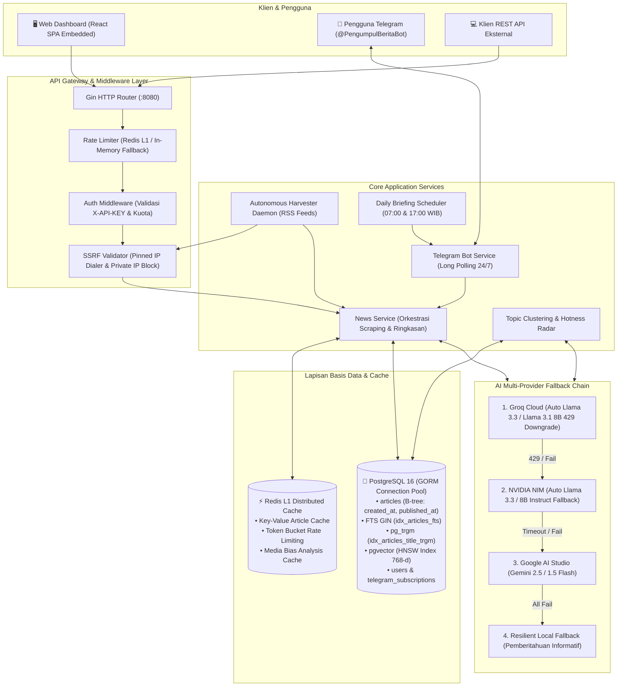

# 📰 Concurrent AI News Aggregator & Intelligence Newsroom

[](https://golang.org)
[](https://gin-gonic.com/)
[](https://react.dev/)
[](https://gorm.io/)
[](https://www.postgresql.org/)
[](https://github.com/pgvector/pgvector)
[](https://redis.io/)
[](https://www.docker.com/)
[](https://groq.com)
[](https://t.me/PengumpulBeritaBot)
[](#)

**Concurrent AI News Aggregator** adalah platform agregator, perayap cerdas (*autonomous crawler*), dan newsroom intelligence performa tinggi berbasis **Golang** dan **React 19**. Sistem ini dirancang untuk melakukan web scraping artikel berita secara paralel (**Fan-Out/Fan-In Goroutines**), klasterisasi tren topik otomatis, analisis bias & sentimen media, pencarian semantik hibrida (**pgvector HNSW + FTS GIN + pg_trgm**), serta fitur **Tanya Jawab Berita (News Q&A)** berbasis RAG dengan batasan topik ketat (*strict guardrails*).

Seluruh sistem dikompilasi ke dalam satu file executable mandiri (**Single-Binary Distribution**) via Go `embed.FS`, terintegrasi dengan **Telegram Bot interaktif 24/7**, scheduler pengarahan harian (*daily briefing*) sadar zona waktu (**WIB**), dan terlindungi oleh pengamanan tingkat enterprise terhadap SSRF, DoS, memory leak, dan race condition.

---

## 📑 Daftar Isi

- [Fitur Utama](#-fitur-utama)
- [Arsitektur Sistem](#-arsitektur-sistem)
- [Teknologi yang Digunakan](#-teknologi-yang-digunakan)
- [Struktur Proyek](#-struktur-proyek)
- [Prasyarat Sistem](#-prasyarat-sistem)
- [Panduan Instalasi & Setup](#-panduan-instalasi--setup)
  - [Metode 1: Menggunakan Docker Compose (Multi-Stage Build)](#metode-1-menggunakan-docker-compose-rekomendasi-cepat-)
  - [Metode 2: Menjalankan Secara Lokal (Manual Go & Vite)](#metode-2-menjalankan-secara-lokal-manual-go--vite)
- [Konfigurasi Lingkungan (.env)](#-konfigurasi-lingkungan-env)
- [Database Migration & Seeding](#-database-migration--seeding)
- [Dokumentasi API Endpoint](#-dokumentasi-api-endpoint)
  - [Endpoint Publik (Tanpa Autentikasi)](#1-endpoint-publik-tanpa-autentikasi)
  - [Endpoint Terproteksi (Header X-API-KEY)](#2-endpoint-terproteksi-header-x-api-key)
- [🤖 Integrasi Telegram Bot (@PengumpulBeritaBot)](#-integrasi-telegram-bot-pengumpulberitabot)
- [🖥️ Antarmuka Web Dashboard (React SPA Embedded)](#-antarmuka-web-dashboard-react-spa-embedded)
- [⚡ Optimasi Kinerja & Skalabilitas](#-optimasi-kinerja--skalabilitas)
- [🔒 Mekanisme Keamanan Enterprise](#-mekanisme-keamanan-enterprise)
- [🧪 Pengujian & Verifikasi (Testing)](#-pengujian--verifikasi-testing)
- [📄 Kontributor & Lisensi](#-kontributor--lisensi)

---

## ✨ Fitur Utama

### 1. ⚡ Konkurensi Paralel Ekstra Cepat (*Fan-Out / Fan-In*)
Memproses ekstraksi teks dan peringkasan untuk banyak URL berita secara simultan menggunakan *Goroutines* dan *Channels*, memangkas waktu tunggu pemrosesan hingga 70-80% dibanding pemrosesan sekuensial.

### 2. 🤖 Multi-Provider LLM Fallback Chain & Auto-Downgrade
Menghubungkan langsung ke cloud AI tanpa ketergantungan proxy perantara:
$$\text{Groq Cloud} \longrightarrow \text{NVIDIA NIM} \longrightarrow \text{Google AI Studio} \longrightarrow \text{Text-Based Local Fallback}$$
- **Deteksi Model Otomatis (`MODEL=auto`)**: Menemukan model aktif terbaru via endpoint `/v1/models` secara dinamis dengan *in-memory cache*.
- **Mitigasi 429 Lighter Model Downgrade**: Jika terjadi *rate limit* (429), sistem otomatis menurunkan beban model ke varian ber-TPM tinggi (misal: `llama-3.3-70b-versatile` $\rightarrow$ `llama-3.1-8b-instant`) serta menerapkan *exponential backoff* berbasis header `Retry-After`.
- **Anti-Caching Pesan Error & Auto-Refund Kuota**: Respon error atau fallback notice sistem tidak pernah disimpan ke cache permanen, dan kuota pengguna dikembalikan secara otomatis jika seluruh penyedia AI gagal.

### 3. 💬 Tanya Jawab Berita (News Q&A) & Real-Time SSE Streaming
- **Strict Guardrails**: Menolak pertanyaan di luar konteks berita secara sopan (*anti-halusinasi* dan *anti-jailbreak*).
- **Server-Sent Events (SSE)**: Streaming token respons bertahap (*typing effect*) via `/api/v1/qa/stream` dengan dukungan pembatalan `AbortController` di frontend.
- **Resilient Fallback Stream**: Jika penyedia AI putus di tengah streaming, sistem memancarkan event `reset` (`StreamControlReset`) dan melakukan failover ke penyedia berikutnya secara transparan tanpa merusak tampilan teks.

### 4. 🔍 Pencarian Hibrida: Semantik Vektor (HNSW) + Full-Text Search (GIN)
- **Dense Embeddings (pgvector)**: Vektor embedding 768 dimensi dengan indeks HNSW cosine distance untuk pencarian berbasis makna.
- **FTS GIN Index (`idx_articles_fts`)**: Menggunakan kamus `'simple'` PostgreSQL yang ramah akronim & istilah Bahasa Indonesia, dilengkapi penyaringan *stop words* dan variasi imbuhan kata.
- **Trigram GIN Index (`pg_trgm`)**: Akselerasi pencarian substring dan fuzzy matching pada kolom `title` dan `summary`.

### 5. 📊 Radar Tren Berita & Klasterisasi Topik Paralel
- Mengelompokkan artikel dari berbagai portal berita berdasarkan kemiripan embedding kosinus.
- Menghitung **Hotness Score** tren secara dinamis berdasarkan volume artikel, diversitas media peliput, dan waktu publikasi.
- Sintesis judul dan rangkuman kluster dieksekusi secara paralel menggunakan **Bounded Worker Pool** untuk efisiensi latensi.

### 6. ⚖️ Spektrum Bias & Analisis Sentimen Komparatif
Membandingkan 2 hingga 5 artikel berita dari berbagai portal berbeda mengenai topik yang sama. AI mengekstrak **konsensus fakta bersama**, **perbedaan sudut pandang (*framing bias*)**, **fakta unik yang ditonjolkan per media**, dan **skor sentimen kuantitatif** (-1.0 sangat kritis s/d +1.0 sangat positif).

### 7. 🤖 Telegram Bot 24/7 & Penjadwal Briefing Harian Sadar Zona Waktu (WIB)
- **Tanya Jawab & URL Drop**: Tanya berita apa saja atau kirim URL langsung di obrolan Telegram.
- **HTML Message Chunking (>4096 Karakter)**: Pemotongan pesan cerdas pada batas alami (paragraf/kalimat) dengan penyeimbangan tag HTML (`<b>`, `<i>`, `<a>`, `<pre>`) agar tidak terjadi error parsing Telegram API.
- **Mitigasi Flood Limit**: Throttling adaptif (maks 25-30 msg/detik), penanganan `Retry-After`, dan de-duplikasi penerima broadcast otomatis.
- **Timezone Awareness Scheduler**: Menjalankan pengarahan berita harian tepat pukul **07:00 WIB** dan **17:00 WIB** di lingkungan container/cloud (UTC) dengan tanggal terlokalisasi Bahasa Indonesia resmi.

### 8. 🛡️ Pengamanan Enterprise & Arsitektur Anti-DDoS
- **Pencegahan SSRF TOCTOU & DNS Rebinding**: Resolver DNS khusus dengan *pinned IP dialer* (`SafeDialContext`), penolakan redirect ke IP privat, serta stripping header sensitif pada cross-domain redirects.
- **Batas Pembacaan Body & Anti Bom Dekompresi**: Pembatasan ukuran body HTTP (`io.LimitReader`) dan mitigasi Gzip bomb.
- **Distributed Rate Limiting**: Token bucket rate limiter berbasis Redis dengan atomic pipeline/Lua script bebas race condition dan anti memory leak.
- **Graceful Shutdown**: Penutupan koneksi HTTP Gin dan background daemons secara teratur dengan penanganan sinyal OS (`SIGINT`, `SIGTERM`).

---

## 🏗 Arsitektur Sistem

Berikut diagram alur data pemrosesan artikel, perayap mandiri, rantai AI, basis data, dan antarmuka pengguna:



---

## 🛠 Teknologi yang Digunakan

| Kategori | Teknologi | Deskripsi |
| :--- | :--- | :--- |
| **Bahasa Pemrograman** | Go (Golang) 1.26+ | Bahasa backend performa tinggi dengan konkurensi native |
| **Web Framework** | Gin Gonic (`github.com/gin-gonic/gin`) | Framework REST API berkecepatan tinggi dengan middleware terstruktur |
| **Frontend Framework** | React 19, TypeScript, Vite 5 | SPA responsif dengan dark/light mode dan aksesibilitas WCAG AA |
| **CSS & Animasi** | Tailwind CSS, Lucide Icons | Styling modern, responsif, dan layout newsroom editorial |
| **Database & ORM** | PostgreSQL 16 & GORM | Database relasional dengan migrasi otomatis dan pool koneksi |
| **Pencarian Semantik** | pgvector (`pgvector-go`) | Pencarian kesamaan vektor embedding 768 dimensi dengan indeks HNSW |
| **Pencarian Teks Penuh**| PostgreSQL FTS (GIN) & `pg_trgm` | Full-Text Search dan Trigram GIN untuk pencarian kata kunci cepat |
| **Cache & Rate Limit** | Redis 7 (`go-redis/v9`) | L1 Cache terdistribusi dan token-bucket rate limiting atomik |
| **Web Scraper** | GoQuery (`PuerkitoBio/goquery`) | Parser HTML berbasis jQuery untuk ekstraksi konten berita bersih |
| **Telegram Bot** | `go-telegram-bot-api/v5` | Bot interaktif long-polling dengan chunking pesan HTML aman |
| **AI Providers** | Groq Cloud, NVIDIA NIM, Google Gemini | LLM canggih dengan deteksi model dinamis dan downgrade otomatis |
| **Kontainerisasi** | Docker & Docker Compose | Multi-stage build 3 tahap berbasis Alpine Linux non-root |

---

## 📁 Struktur Proyek

```
News-Aggregator/
├── .agent/                       # Dokumen perencanaan, PRD, dan spesifikasi arsitektur
├── .github/
│   └── workflows/
│       └── ci.yml                # CI pipeline otomatis (Unit tests + Docker build)
├── cmd/
│   ├── api/
│   │   └── main.go               # Entry point server HTTP Gin & daemons background
│   ├── seed/
│   │   └── main.go               # Program seeder database dan user pengujian
│   └── e2e_test/
│       └── main.go               # Test suite otomatis End-to-End & Concurrency Stress Test
├── docs/                         # Dokumentasi Swagger / OpenAPI 2.0
├── internal/
│   ├── ai/                       # AI Layer (Integrasi multi-provider LLM & Embeddings)
│   │   ├── client.go             # Client HTTP OpenAI-compatible dengan retry 429 cerdas
│   │   ├── model_resolver.go     # Auto model discovery dengan in-memory cache
│   │   ├── groq.go               # Provider Groq Cloud
│   │   ├── nvidia.go             # Provider NVIDIA NIM
│   │   ├── gemini.go             # Provider Google AI Studio (Gemini)
│   │   ├── embedding.go          # Generator dense vector embedding (768 dimensi)
│   │   ├── local_fallback.go     # Fallback gracefully terisolasi
│   │   └── chain.go              # FallbackChain (Chain of Responsibility & SSE Reset)
│   ├── cache/                    # Redis L1 Cache layer & distributed rate limiting
│   ├── clustering/               # Topic Clustering Engine & Parallel Synthesis Worker Pool
│   ├── crawler/                  # Autonomous Harvester Engine & RSS parser
│   ├── delivery/
│   │   └── http/
│   │       └── handler.go        # HTTP Handlers (Summarize, Q&A, Compare, Clusters, Auth)
│   ├── middleware/
│   │   ├── auth.go               # Autentikasi API Key & pemeriksaan kuota
│   │   └── ratelimit.go          # Token bucket rate limiting (Redis / In-Memory)
│   ├── models/                   # GORM Entities (User, Article, TopicCluster, TelegramSub)
│   ├── repository/               # PostgreSQL Data Access (Pool, FTS, Trigram, pgvector, B-Trees)
│   │   ├── db_pool.go            # Konfigurasi GORM connection pool & lifetime
│   │   ├── postgres.go           # Implementasi repository & inisialisasi indeks
│   │   └── search_builder.go     # Sanitasi query FTS, stop words, & prefix variants
│   ├── scheduler/                # Daily Briefing Scheduler (Timezone-Aware WIB)
│   ├── service/                  # Business logic (NewsService, Safe HTTP Client, SSRF Guard)
│   ├── strutil/                  # UTF-8 rune truncation & text manipulation helpers
│   └── telegram/                 # Telegram Bot Service (Two-Way Chat, HTML Chunking, Flood-Wait)
├── web/                          # Frontend React 19 + TypeScript + Vite Single Page Application
│   ├── src/                      # Komponen React, hooks, styles, dan assets
│   ├── package.json              # Dependensi npm frontend
│   ├── vite.config.ts            # Konfigurasi bundler Vite
│   └── web.go                    # Go embed.FS pengemas artefak dist/ ke dalam binary
├── .dockerignore                 # Filter eksklusi build konteks Docker
├── .env.example                  # Template variabel lingkungan lengkap
├── docker-compose.yml            # Orkestrasi Docker (API Server, PostgreSQL 16 + pgvector, Redis)
├── Dockerfile                    # 3-Stage Multi-Stage Production Build (Node -> Go -> Alpine)
├── go.mod                        # Definisi modul dan dependensi Golang
├── go.sum                        # Checksum dependensi Golang
└── README.md                     # Dokumentasi komprehensif sistem
```

---

## 💻 Prasyarat Sistem

Sebelum menjalankan proyek ini, pastikan sistem Anda telah memiliki:
1. **Docker & Docker Compose** *(Sangat Direkomendasikan)*: Versi 24+
2. **Atau Secara Lokal:**
   - **Go (Golang)**: Versi 1.21+ (disarankan Go 1.26+)
   - **Node.js**: Versi 20+ & npm (jika ingin mengompilasi frontend secara mandiri)
   - **PostgreSQL**: Server PostgreSQL 15+ dengan ekstensi `vector` (pgvector) dan `pg_trgm`
   - **Redis**: Server Redis 6+ (opsional untuk L1 Cache & rate limiting)
3. **API Keys** (Minimal salah satu untuk menjalankan fitur AI):
   - [Groq Cloud API Key](https://console.groq.com/keys)
   - [NVIDIA NIM API Key](https://build.nvidia.com)
   - [Google AI Studio API Key](https://aistudio.google.com/)
4. **Telegram Bot Token** *(Opsional, untuk integrasi bot)*: Didapatkan dari [@BotFather](https://t.me/BotFather).

---

## 🚀 Panduan Instalasi & Setup

### Metode 1: Menggunakan Docker Compose (Rekomendasi Cepat ⚡)
Docker Compose akan secara otomatis menjalankan:
1. **Frontend Builder (Node.js 20)**: Menjalankan `npm ci` dan `npm run build` untuk menghasilkan bundle statis React/Vite.
2. **Backend Builder (Golang Alpine)**: Menyalin bundle frontend ke `web/dist` dan mengompilasi binary statis Go (`cmd/api` dan `cmd/seed`) dengan `//go:embed all:dist`.
3. **Production Runtime (Alpine 3.20)**: Image minimalis non-root user `appuser` yang mengeksekusi server API mandiri.
4. **PostgreSQL 16**: Lengkap dengan ekstensi `pgvector`.
5. **Redis**: Cache L1 terdistribusi.

Langkah-langkah:
```bash
# 1. Clone repositori
git clone https://github.com/Lesmana24/Concurrent-AI-News-Aggregator.git
cd Concurrent-AI-News-Aggregator

# 2. Siapkan file environment
cp .env.example .env
# Edit .env dan masukkan API Key AI Anda (GROQ_API_KEY, NVIDIA_NIM_API_KEY, dsb.)

# 3. Jalankan container
docker compose up -d --build

# 4. Jalankan seeder database awal di container
docker compose run --rm api /app/seed
```

Aplikasi dan dashboard web siap diakses di: **`http://localhost:8080`**!

---

### Metode 2: Menjalankan Secara Lokal (Manual Go & Vite)

#### 1. Setup Backend Go:
```bash
# Clone & masuk direktori
git clone https://github.com/Lesmana24/Concurrent-AI-News-Aggregator.git
cd Concurrent-AI-News-Aggregator

# Unduh dependensi backend
go mod tidy

# Konfigurasi file .env
cp .env.example .env
```
*Pastikan database PostgreSQL lokal telah berjalan dan ekstensi `vector` serta `pg_trgm` telah diaktifkan.*

#### 2. Build Frontend React (Opsional jika ingin memperbarui Web UI):
```bash
cd web
npm install
npm run build
cd ..
```
*Artefak produksi akan otomatis tersimpan di `web/dist` dan disematkan ke binary Go.*

#### 3. Jalankan Seeder Database:
```bash
go run cmd/seed/main.go
```

#### 4. Nyalakan Server API:
```bash
go run cmd/api/main.go
```
Server dan Web Dashboard aktif di: **`http://localhost:8080`**.

---

## ⚙️ Konfigurasi Lingkungan (`.env`)

Berikut daftar lengkap parameter konfigurasi pada `.env`:

```env
# Port aplikasi server (default: 8080)
PORT=8080

# Konfigurasi PostgreSQL
DB_HOST=localhost
DB_PORT=5432
DB_USER=postgres
DB_PASSWORD=password
DB_NAME=news_aggregator

# Konfigurasi Database Connection Pool GORM (Opsional)
DB_MAX_OPEN_CONNS=75
DB_MAX_IDLE_CONNS=20
DB_CONN_MAX_LIFETIME=30m
DB_CONN_MAX_IDLE_TIME=10m

# Redis L1 Cache & Distributed Rate Limiting (Kosongkan REDIS_HOST untuk mode in-memory)
REDIS_HOST=localhost
REDIS_PORT=6379
REDIS_PASSWORD=

# Rate Limiting (Maksimal request per menit per IP/Key, default: 60)
RATE_LIMIT_RPM=60

# Penyedia AI (Gunakan 'auto' untuk auto-discovery model aktif terbaru)
GROQ_API_KEY=gsk_your_groq_api_key_here
GROQ_MODEL=auto

NVIDIA_NIM_API_KEY=nvapi-your_nvidia_api_key_here
NVIDIA_NIM_MODEL=auto

GEMINI_API_KEY=your_gemini_api_key_here
GEMINI_MODEL=auto

# Timeout pemanggilan AI dalam detik (default: 25)
AI_TIMEOUT_SECONDS=25

# Izinkan URL internal / localhost (Hanya untuk pengujian lokal; set false di produksi)
ALLOW_INTERNAL_URLS=false

# Telegram Bot Integration (Dapatkan token dari @BotFather)
TELEGRAM_BOT_TOKEN=your_telegram_bot_token
TELEGRAM_BOT_ENABLED=true

# Autonomous News Harvester / Crawler
CRAWLER_ENABLED=true
CRAWLER_INTERVAL_MINUTES=15
CRAWLER_MAX_PER_FEED=3

# Automated Daily Briefing & Push Notification Scheduler
BRIEFING_ENABLED=true
BRIEFING_TIMEZONE=Asia/Jakarta
BRIEFING_HOURS=07:00,17:00
BRIEFING_MAX_ARTICLES=5

# Topic Clustering & Trending Radar
CLUSTER_SIMILARITY_THRESHOLD=0.78
CLUSTER_HOURS_WINDOW=48
CLUSTER_INTERVAL_MINUTES=30
CLUSTER_SYNTHESIS_WORKERS=4
```

---

## 🗄️ Database Migration & Seeding

Menjalankan program seeder:
```bash
go run cmd/seed/main.go
```

**Output Seeder:**
```text
Connecting to PostgreSQL at 127.0.0.1:5432 (database: news_aggregator)...
Connected successfully to PostgreSQL!
AutoMigrate completed: tables 'users' and 'articles' are ready.
Seed user created successfully!
  - ID: 1
  - Email: developer@example.com
  - APIKey: test-key-123
  - Quota: 50
Total users in database: 1
```

> **Kredensial Bawaan Pengujian:**
> - **API Key**: `test-key-123`
> - **Kuota**: `50` request

---

## 📡 Dokumentasi API Endpoint

> 💡 **Interactive Swagger UI**: Dokumentasi OpenAPI interaktif lengkap tersedia di:  
> 👉 **`http://localhost:8080/swagger/index.html`**  
> *(Gunakan tombol **Authorize** dan masukkan `test-key-123` untuk menguji endpoint).*

Semua response HTTP menyertakan header penelusuran `X-Request-ID` dan dicatat ke log dalam format JSON terstruktur via Go `log/slog`.

---

### 1. Endpoint Publik (Tanpa Autentikasi)

#### A. Health Check
Mengecek status kesehatan server dan dependensi.
- **Method**: `GET`
- **URL**: `/api/v1/health`
- **Response (`200 OK`)**:
  ```json
  { "status": "ok" }
  ```

#### B. Registrasi Pengguna Baru
Mendaftarkan akun baru secara mandiri dan langsung mendapatkan API Key serta kuota gratis.
- **Method**: `POST`
- **URL**: `/api/v1/auth/register`
- **Request Body**:
  ```json
  {
    "email": "reader@example.com"
  }
  ```
- **Response (`201 Created`)**:
  ```json
  {
    "id": 2,
    "email": "reader@example.com",
    "api_key": "cna-a1b2c3d4e5f6...",
    "quota": 100,
    "created_at": "2026-11-12T08:00:00Z"
  }
  ```

#### C. Radar Tren & Klaster Topik Berita
Melihat daftar klaster berita trending yang dihitung secara otomatis berdasarkan *Hotness Score*.
- **Method**: `GET`
- **URL**: `/api/v1/news/trending?limit=8`
- **Response (`200 OK`)**:
  ```json
  {
    "total_clusters": 5,
    "computed_at": "2026-11-12T08:00:00Z",
    "topics": [
      {
        "id": 1,
        "title": "Sidang Putusan MK Mengenai Ambang Batas Parlemen",
        "summary": "Mahkamah Konstitusi mengabulkan sebagian uji materi ambang batas parlemen...",
        "image_url": "https://images.unsplash.com/...",
        "article_count": 8,
        "unique_outlets": 4,
        "outlets": ["Antara News", "CNBC Indonesia", "Detik", "Kompas"],
        "hotness_score": 28.5,
        "last_updated": "2026-11-12T07:45:00Z"
      }
    ]
  }
  ```

#### D. Detail Klaster Berita
Melihat ringkasan sintesis mendalam beserta seluruh artikel yang tergabung dalam satu klaster.
- **Method**: `GET`
- **URL**: `/api/v1/news/clusters/:id`

#### E. Wire Artikel Berita Terkini
Mendapatkan feed artikel berita terbaru hasil perayapan dengan filter media/sumber.
- **Method**: `GET`
- **URL**: `/api/v1/news/recent?limit=20&source=Antara%20News`

#### F. Pencarian Semantik & Kata Kunci Hibrida
Mencari arsip berita menggunakan kombinasi vektor semantik dan FTS GIN.
- **Method**: `GET`
- **URL**: `/api/v1/news/search?q=kebijakan+energi+terbarukan&limit=5`

#### G. Status Perayap Mandiri (Harvester Status)
Melihat metrik dan statistik eksekusi crawler berita.
- **Method**: `GET`
- **URL**: `/api/v1/crawler/status`

---

### 2. Endpoint Terproteksi (Header `X-API-KEY`)

Sertakan header wajib pada setiap request:
```http
X-API-KEY: test-key-123
```

#### A. Profil Pengguna & Sisa Kuota
Melihat detail profil dan sisa kuota (dioptimasi tanpa query ganda ke basis data).
- **Method**: `GET`
- **URL**: `/api/v1/user/me`
- **Response (`200 OK`)**:
  ```json
  {
    "api_key": "test-key-123",
    "quota": 48
  }
  ```

#### B. Rotasi API Key Pengguna
Membuat API Key baru secara aman dan membatalkan kunci lama secara otomatis.
- **Method**: `POST`
- **URL**: `/api/v1/user/rotate-key`
- **Response (`200 OK`)**:
  ```json
  {
    "id": 1,
    "email": "developer@example.com",
    "old_api_key": "test-key-123",
    "new_api_key": "cna-new-key-789xyz...",
    "quota": 48,
    "rotated_at": "2026-11-12T08:15:00Z"
  }
  ```

#### C. Peringkasan Berita Paralel (*Bulk Summarization*)
Menerima array URL berita, mengekstrak konten secara paralel (*Fan-Out/Fan-In*), dan mengembalikan ringkasan padat 3 kalimat dalam Bahasa Indonesia.
- **Method**: `POST`
- **URL**: `/api/v1/summarize`
- **Request Body**:
  ```json
  {
    "urls": [
      "https://www.kompas.tv/regional/698663/ada-61-titik-demo-29-oktober-di-jakarta-hari-ini-polisi-siapkan-pengamanan"
    ]
  }
  ```
- **Response (`200 OK`)**:
  ```json
  [
    {
      "title": "Ada 61 Titik Demo di Jakarta Hari Ini, Polisi Siapkan Pengamanan",
      "url": "https://www.kompas.tv/regional/698663/...",
      "summary": "Polda Metro Jaya mengungkapkan adanya 61 titik aksi penyampaian pendapat di Jakarta hari ini. Untuk mengawal jalannya aksi, personel gabungan TNI, Polri, dan Pemprov DKI disiagakan di berbagai lokasi strategis. Kepolisian mengimbau seluruh massa untuk menyampaikan aspirasi dengan tertib dan damai.",
      "source": "Kompas TV"
    }
  ]
  ```

#### D. Tanya Jawab Berita Spesifik (*News Q&A*)
Mengajukan pertanyaan natural mengenai isi artikel tertentu (maksimal 5 URL) dengan batasan topik ketat.
- **Method**: `POST`
- **URL**: `/api/v1/qa` *(atau alias: `/api/v1/news/qa`)*
- **Request Body**:
  ```json
  {
    "urls": [
      "https://www.kompas.tv/regional/698663/..."
    ],
    "question": "Berapa banyak titik aksi yang dilaporkan pihak kepolisian?"
  }
  ```
- **Response (`200 OK`)**:
  ```json
  {
    "question": "Berapa banyak titik aksi yang dilaporkan pihak kepolisian?",
    "answer": "Pihak kepolisian melaporkan terdapat 61 titik aksi penyampaian pendapat di wilayah Jakarta pada hari ini.",
    "sources": ["https://www.kompas.tv/regional/698663/..."],
    "source": "Groq"
  }
  ```

#### E. Tanya Jawab Streaming Real-Time (Server-Sent Events)
Mengembalikan jawaban kata demi kata (*typing effect*) secara real-time via SSE.
- **Method**: `POST`
- **URL**: `/api/v1/qa/stream`
- **Contoh Stream Output**:
  ```text
  event:token
  data:Berdasarkan

  event:token
  data: laporan

  event:token
  data: kepolisian, terdapat 61 titik aksi...

  event:done
  data:{"status":"completed"}
  ```

#### F. Tanya Jawab Global RAG (Lintas Seluruh Arsip Berita)
Menjawab pertanyaan umum berdasarkan seluruh database berita yang tersimpan tanpa perlu menyertakan URL.
- **Method**: `POST`
- **URL**: `/api/v1/qa/global`
- **Request Body**:
  ```json
  {
    "question": "Bagaimana perkembangan regulasi kendaraan listrik nasional?"
  }
  ```

#### G. Analisis Komparatif & Spektrum Bias Media
Membandingkan framing pemberitaan dan sentimen dari 2 hingga 5 portal berita terhadap topik yang sama.
- **Method**: `POST`
- **URL**: `/api/v1/news/compare`
- **Request Body**:
  ```json
  {
    "urls": [
      "https://nasional.kompas.com/read/2026/10/29/demo-jakarta",
      "https://news.detik.com/berita/d-698663/unjuk-rasa-patung-kuda",
      "https://koran.tempo.co/read/nasional/suara-massa-buruh"
    ]
  }
  ```
- **Response (`200 OK`)**:
  Menyajikan konsensus fakta, skor sentimen kuantitatif per media (-1.0 s/d +1.0), fokus framing dominan, perbedaan sudut pandang, dan rangkuman objektif.

#### H. Hitung Ulang Klaster Tren Berita
Memicu perhitungan ulang klaster berita dan sintesis topik secara manual di latar belakang.
- **Method**: `POST`
- **URL**: `/api/v1/news/clusters/recompute`

#### I. Memicu Perayapan Berita Mandiri
Menjalankan siklus perayapan RSS feed nasional secara manual.
- **Method**: `POST`
- **URL**: `/api/v1/crawler/trigger`

#### J. Siaran Notifikasi Telegram & Statistik Pelanggan
- **`POST /api/v1/notifications/broadcast`**: Mengirim pesan siaran darurat/pengumuman ke seluruh pelanggan bot Telegram dengan proteksi duplikasi dan pembatasan kecepatan aman.
- **`GET /api/v1/notifications/subscriptions`**: Melihat jumlah pelanggan aktif dan topik yang paling diminati.

---

## 🤖 Integrasi Telegram Bot (@PengumpulBeritaBot)

Platform ini terintegrasi langsung dengan **Telegram Bot 24/7** ([@PengumpulBeritaBot](https://t.me/PengumpulBeritaBot)) yang berjalan menggunakan *Long Polling* konkurensi tinggi.

### 🌟 Fitur & Perintah Bot:
| Perintah | Deskripsi |
| :--- | :--- |
| `/start` | Memulai interaksi dan menampilkan menu sambutan interaktif |
| `/help` | Menampilkan panduan lengkap penggunaan bot |
| `/briefing` | Meminta eksekutif summary berita nasional hari ini secara instan |
| `/subscribe <topik>` | Berlangganan pengarahan berita harian (contoh: `/subscribe politik` atau `/subscribe ekonomi`) |
| `/unsubscribe` | Membatalkan langganan pengarahan berita harian |
| `/topics` | Menampilkan daftar topik berita populer yang tersedia |
| `/stats` | Menampilkan statistik jumlah pelanggan dan topik aktif |
| `/search <query>` | Mencari arsip berita menggunakan pencarian makna semantik vektor |
| `/compare <url1> <url2>` | Menganalisis perbedaan sudut pandang (*framing bias*) dua media berita |
| *Kirim URL Berita Langsung* | Ekstraksi dan peringkasan 3 kalimat instan secara otomatis |
| *Kirim Pertanyaan Bebas* | Q&A interaktif dengan Global RAG dan sitasi tautan sumber asli |

### 🛡️ Keandalan & Ketahanan Bot Telegram:
- **HTML Message Chunking (>4096 Karakter)**: Pesan panjang dipecah secara natural pada batas paragraf atau kalimat. Tag pembuka HTML (`<b>`, `<i>`, `<a>`, `<pre>`) diseimbangkan dan ditutup secara otomatis pada potongan pertama, lalu dibuka kembali pada potongan berikutnya untuk mencegah *Telegram 400 Bad Request: can't parse entities*.
- **Mitigasi Flood Limit**: Throttling otomatis (maksimum 25 pesan/detik), parsing jeda waktu `Retry-After`, dan backoff eksponensial.
- **Deduplikasi Broadcast**: Penerima yang berlangganan multi-topik di-deduplikasi sehingga hanya menerima satu pesan siaran unik per siklus.
- **Timezone Awareness**: Pengarahan harian dievaluasi pada zona waktu `Asia/Jakarta` (**WIB**) dengan penamaan bulan Bahasa Indonesia resmi (misal: `"12 November 2026"`).
- **Auto-Deactivation**: Akun pengguna yang memblokir bot secara otomatis dinonaktifkan dari database agar tidak membuang kuota network.

---

## 🖥️ Antarmuka Web Dashboard (React SPA Embedded)

Aplikasi menyertakan dashboard Single Page Application (SPA) modern yang dibangun menggunakan **React 19**, **TypeScript**, **Vite**, dan **Tailwind CSS**. Frontend ini dikemas langsung ke dalam binary Go server (`cmd/api`) melalui `//go:embed all:dist` pada package `web`.

### Fitur Antarmuka Pengguna:
- **Newsroom Editorial Wire**: Tampilan kartu visual (*Cards View*) dan tampilan baris berdensitas tinggi (*Compact Wire View*) dengan toggle yang tersimpan di `localStorage`.
- **Trending Topics & Hotness Radar**: Menampilkan klaster isu terhangat lengkap dengan indikator badge sentimen dan diversitas outlet media.
- **Media Bias & Sentiment Spectrum**: Visualisasi spektrum framing berita lintas portal nasional.
- **Real-Time Semantic Inquiry**: Obrolan tanya jawab artikel dengan streaming SSE, indikator animasi pengetikan, auto-scroll cerdas, dan pembatalan stream via `AbortController`.
- **Quick Scraper & Digest**: Form ekstraksi instan dengan validasi URL client-side dan indikator status scraping.
- **User Key Management Modal**: Antarmuka untuk pendaftaran API Key dan rotasi kunci mandiri.
- **Command Palette (`Ctrl+K` / `Cmd+K`)**: Navigasi cepat dan pencarian aksi dengan dukungan klik backdrop dan tombol dismiss di layar ponsel.
- **Aksesibilitas & Tema**: Dark/Light mode toggle, shimmer skeleton loaders, dan kepatuhan penuh terhadap standar **WCAG 2.1 AA**.

---

## ⚡ Optimasi Kinerja & Skalabilitas

1. **Eliminasi Full Table Scan via Indeks Database**:
   - Kolom `created_at` dan `published_at` diindeks menggunakan B-tree (`idx_articles_created_at`, `idx_articles_published_at`, `idx_articles_source_created_at`).
   - Query rentang waktu (`WHERE created_at >= $1 OR published_at >= $1`) memanfaatkan **PostgreSQL BitmapOr** untuk pencarian sub-milidetik.
   - Pencarian kata kunci menggunakan indeks **PostgreSQL Full-Text Search (GIN)** dan **Trigram (`pg_trgm`)**, meniadakan scan sekuensial `LIKE %...%`.
2. **Database Connection Pooling (GORM)**:
   - Pengaturan batas koneksi terbuka (`SetMaxOpenConns`), koneksi menganggur (`SetMaxIdleConns`), serta waktu hidup koneksi (`SetConnMaxLifetime`, `SetConnMaxIdleTime`) untuk mencegah kehabisan socket PostgreSQL pada beban tinggi.
3. **Shared HTTP Client & TCP Keep-Alive**:
   - Penggunaan satu instance `http.Client` thread-safe yang dibagikan ke seluruh service dengan connection pooling TCP Keep-Alive untuk mengeliminasi latensi *TCP handshake* dan *TLS negotiation* berulang.
4. **Pre-kompilasi Regular Expression**:
   - Seluruh regex pada paket `service`, `strutil`, `crawler`, dan `telegram` dikompilasi satu kali ke level paket (`regexp.MustCompile`) untuk menghemat alokasi memori dan siklus CPU pada hot path.
5. **Paralelisasi Sintesis Klaster**:
   - Sintesis judul dan rangkuman kluster berita dijalankan secara paralel menggunakan Bounded Worker Pool Goroutines, memangkas waktu kalkulasi klaster dari 40+ detik menjadi di bawah 4 detik.
6. **Zero Duplicate Queries**:
   - Endpoint `/api/v1/user/me` menggunakan kembali objek user yang telah di-fetch oleh `AuthMiddleware`, mengeliminasi query redundant ke PostgreSQL.
7. **Multi-byte UTF-8 Rune Safety**:
   - Pemotongan string menggunakan penghitungan `[]rune` alih-alih byte slicing untuk mencegah pemotongan karakter multi-byte yang berisiko merusak string atau memicu runtime panic.

---

## 🔒 Mekanisme Keamanan Enterprise

1. **SSRF Defense Tingkat Lanjut (TOCTOU & DNS Rebinding)**:
   - Validasi IP pra-koneksi dengan resolver kustom.
   - `SafeDialContext` mengunci koneksi TCP langsung ke IP publik yang telah divalidasi (*pinned IP*), mencegah serangan DNS Rebinding di mana DNS berubah antara waktu validasi dan waktu koneksi HTTP.
   - Pengecekan HTTP 301/302 redirect untuk memblokir pengalihan ke IP privat atau port non-standar berbahaya (SSH, Telnet, Redis, Database, Cloud Metadata `169.254.169.254`).
   - Penghapusan header sensitif (`Authorization`, `Cookie`) pada pengalihan lintas domain.
2. **Anti-DoS via Unbounded Body & Decompression Bombs**:
   - Seluruh pembacaan response body dibatasi menggunakan `io.LimitReader` (maksimal 5 MB untuk scraping artikel, 10 MB untuk feed).
   - Pembacaan stream Gzip/Deflate dibatasi secara ketat untuk mencegah serangan *decompression bomb* (zip bomb).
3. **Pencegahan Bypass Kuota & Perlindungan Kunci Sistem**:
   - Kunci API internal crawler dan telegram bot menggunakan token kriptografi acak yang aman (`crypto/rand`).
   - Endpoint publik tidak dapat menyuntikkan atau menyalahgunakan kunci sistem untuk memotong kuota.
4. **Atomic Rate Limiting**:
   - Rate limiting berbasis Redis dieksekusi menggunakan script atomik / pipeline untuk mengeliminasi race condition dan kebocoran memori.
5. **Anti-SQL Injection & Sanitasi Konten**:
   - Seluruh query dieksekusi melalui ORM GORM dengan parameterized queries.
   - Parser HTML membuang tag `<script>`, `<style>`, `<iframe>`, dan tag berbahaya lainnya sebelum teks diteruskan ke LLM.

---

## 🧪 Pengujian & Verifikasi (Testing)

Proyek ini memiliki pengujian komprehensif yang mencakup unit test, concurrency test, dan end-to-end suite.

### 1. Menjalankan Seluruh Unit Test:
```bash
go test -v ./...
```
*Menguji modul AI Fallback Chain, URL Filter, SSRF Guard, Model Resolver, Telegram Chunker, Database Pool, Scheduler Timezone, dan Repository FTS/B-Trees.*

### 2. Menjalankan Uji Concurrency & Race Detector:
```bash
go test -race ./internal/...
```

### 3. Menjalankan End-to-End (E2E) Stress Test Suite:
```bash
go run cmd/e2e_test/main.go
```

**Hasil Verifikasi E2E:**
```text
================================================================================
          TAHAP 5: PENGUJIAN API ENDPOINT & STRESS TEST (E2E SUITE)
================================================================================
[TEST 1] GET /api/v1/health                           -> PASS (HTTP 200)
[TEST 2] POST /api/v1/summarize (Missing API Key)      -> PASS (HTTP 401)
[TEST 3] POST /api/v1/summarize (Invalid API Key)      -> PASS (HTTP 401)
[TEST 4] POST /api/v1/summarize (Empty URLs Array)     -> PASS (HTTP 400)
[TEST 5] POST /api/v1/summarize (SSRF Localhost Block) -> PASS (HTTP 400)
[TEST 6] POST /api/v1/summarize (Valid News Scraping)  -> PASS (HTTP 200, Latency 2.1s)
[TEST 7] POST /api/v1/summarize (DB Cache Hit)         -> PASS (HTTP 200, Instant Cache)
[TEST 8] POST /api/v1/qa (On-Topic Question)           -> PASS (HTTP 200, Accurate Answer)
[TEST 9] POST /api/v1/qa (Off-Topic Guardrail Refusal) -> PASS (HTTP 200, Declined Politely)
[TEST 10] TAHAP 5.3: 10 Concurrent Requests            -> PASS (10/10 OK, No Deadlock)
================================================================================
             SELURUH PENGUJIAN TAHAP 5 TELAH SELESAI & LULUS 100%!
================================================================================
```

---

## 📄 Kontributor & Lisensi

Proyek ini dikembangkan sebagai platform agregasi berita mandiri dan newsroom intelligence berbasis kecerdasan buatan terdistribusi.

Didistribusikan di bawah lisensi **MIT License**. Silakan gunakan, pelajari, dan kembangkan secara bebas sesuai kebutuhan Anda.
