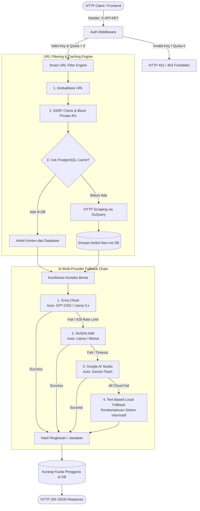

# 📰 Concurrent AI News Aggregator

[](https://golang.org)
[](https://gin-gonic.com/)
[](https://gorm.io/)
[](https://www.postgresql.org/)
[](https://www.docker.com/)
[](https://groq.com)
[-success)](#)

**Concurrent AI News Aggregator** adalah layanan REST API backend performa tinggi berbasis **Golang** yang dirancang untuk melakukan *web scraping*, ekstraksi teks berita cerdas, peringkasan artikel secara paralel (**Fan-Out/Fan-In Goroutines**), serta fitur **Tanya Jawab Berita (News Q&A)** dengan batasan topik (*strict topic guardrails*).

Sistem ini terintegrasi langsung dengan penyedia LLM papan atas (**Groq Cloud**, **NVIDIA NIM**, dan **Google AI Studio**) menggunakan rantai kegagalan (*fallback chain*) otomatis, deteksi model aktif dinamis (**Auto Model Discovery**), dan sistem pencadangan cerdas (**PostgreSQL Cache-First**) untuk menghemat kuota token dan meminimalisasi latensi.

---

## 📑 Daftar Isi

- [Fitur Utama](#-fitur-utama)
- [Arsitektur Sistem](#-arsitektur-sistem)
- [Teknologi yang Digunakan](#-teknologi-yang-digunakan)
- [Struktur Proyek](#-struktur-proyek)
- [Prasyarat Sistem](#-prasyarat-sistem)
- [Panduan Instalasi & Setup](#-panduan-instalasi--setup)
- [Konfigurasi Lingkungan (.env)](#-konfigurasi-lingkungan-env)
- [Database Migration & Seeding](#-database-migration--seeding)
- [Dokumentasi API Endpoint](#-dokumentasi-api-endpoint)
  - [1. Health Check](#1-health-check)
  - [2. Peringkasan Berita (Summarize)](#2-peringkasan-berita-bulk-summarization)
  - [3. Tanya Jawab Berita (News Q&A)](#3-tanya-jawab-berita-news-qa)
- [Pengujian & Verifikasi (Testing)](#-pengujian--verifikasi-testing)
- [Mekanisme Keamanan](#-mekanisme-keamanan)
- [Kontributor & Lisensi](#-kontributor--lisensi)

---

## ✨ Fitur Utama

### 1. ⚡ Konkurensi Paralel Ekstra Cepat (*Fan-Out / Fan-In*)
Memproses ekstraksi teks dan peringkasan untuk banyak URL berita secara simultan menggunakan *Goroutines* dan *Channels*, memangkas waktu tunggu pemrosesan hingga 70-80% dibanding pemrosesan sekuensial.

### 2. 💬 Tanya Jawab Berita (*News Q&A*) & *Strict Guardrails*
Pengguna dapat mengajukan pertanyaan bebas mengenai artikel berita yang dimasukkan. Dilengkapi batasan topik ketat:
- **Fakta Terikat**: AI hanya menjawab fakta yang secara eksplisit tertulis di dalam artikel.
- **Anti-Halusinasi & Anti-Jailbreak**: Pertanyaan di luar topik berita (misal: tanya resep makanan, pengetahuan umum acak, atau manipulasi prompt) akan ditolak secara sopan.

### 3. 🛡️ Mesin Filter URL Cerdas & Proteksi SSRF
- **Deduplikasi URL**: Menghapus duplikasi URL identik dalam request.
- **Pencegahan SSRF (*Server-Side Request Forgery*)**: Memblokir akses ke alamat IP privat, `localhost`, `127.0.0.1`, subnet internal, dan IP metadata cloud (`169.254.x.x`).
- **Penyaringan Ekstensi**: Menolak URL dokumen/binary non-artikel (`.pdf`, `.zip`, `.exe`, `.jpg`, `.mp4`).
- **Batas Maksimal**: Membatasi maksimal 5 URL per pertanyaan Q&A untuk efisiensi context window.

### 4. 💾 *Persistent Caching* Berbasis PostgreSQL (*Cache-First*)
Setiap artikel yang berhasil di-scrape disimpan ke database. Pemanggilan berikutnya untuk URL yang sama akan membaca data dari PostgreSQL dalam hitungan milidetik tanpa melakukan HTTP scraping ulang dan tanpa membuang kuota token AI.

### 5. 🤖 Multi-Provider LLM Fallback Chain
Menghubungkan langsung ke cloud AI tanpa ketergantungan proxy perantara:
$$\text{Groq Cloud} \longrightarrow \text{NVIDIA NIM} \longrightarrow \text{Google AI Studio} \longrightarrow \text{Text-Based Local Fallback}$$
Jika penyedia utama mengalami *rate limit* (429), *timeout*, atau gangguan (5xx), sistem otomatis beralih ke penyedia berikutnya secara transparan.

### 6. 🔄 Auto Model Discovery (`MODEL=auto`)
Sistem secara dinamis memeriksa katalog model aktif dari penyedia via `/v1/models` dan menyimpannya ke *in-memory cache*. Jika ada model lama yang didepresiasi oleh penyedia AI di masa depan, sistem otomatis beralih ke model aktif terbaru tanpa perlu merubah kode sumber.

### 7. 🔑 Autentikasi API Key & Manajemen Kuota
Middleware Gin melindungi endpoint dengan memvalidasi header `X-API-KEY`. Setiap pengguna memiliki kuota request yang berkurang secara otomatis ketika memproses artikel baru.

---

## 🏗 Arsitektur Sistem

Berikut diagram alur data pemrosesan artikel dan rantai kecerdasan buatan (*AI Fallback Chain*):



---

## 🛠 Teknologi yang Digunakan

| Kategori | Teknologi | Deskripsi |
| :--- | :--- | :--- |
| **Bahasa Pemrograman** | Go (Golang) 1.26+ | Bahasa utama dengan performa tinggi dan konkurensi native |
| **Web Framework** | Gin Gonic (`github.com/gin-gonic/gin`) | Framework HTTP REST API berkecepatan tinggi |
| **Database & ORM** | PostgreSQL & GORM | Database relasional dengan ORM berfitur migrasi otomatis |
| **Web Scraper** | GoQuery (`github.com/PuerkitoBio/goquery`) | Parser HTML berbasis jQuery untuk ekstraksi elemen berita |
| **Konfigurasi** | GoDotEnv (`github.com/joho/godotenv`) | Manajemen variabel lingkungan (*environment variables*) |
| **AI Providers** | Groq Cloud, NVIDIA NIM, Google AI | Model LLM berkecepatan tinggi untuk peringkasan dan Q&A |
| **Pengujian** | Testify (`github.com/stretchr/testify`) | Toolkit pengujian assertions dan mock objects |

---

## 📁 Struktur Proyek

Proyek ini dibangun menggunakan prinsip **Clean Architecture**:

```
News-Aggregator/
├── .agent/                       # Dokumen perencanaan, PRD, Techspec, dan API Contract
├── .github/
│   └── workflows/
│       └── ci.yml                # Automated CI pipeline (Unit tests -race + Docker build)
├── cmd/
│   ├── api/
│   │   └── main.go               # Entry point aplikasi server API utama
│   ├── seed/
│   │   └── main.go               # Program seeder database dan user pengujian
│   └── e2e_test/
│       └── main.go               # Test suite otomatis End-to-End & Concurrency Stress Test
├── internal/
│   ├── ai/                       # AI Layer (Integrasi LLM langsung multi-provider)
│   │   ├── types.go              # Interface Summarizer, QAEngine, Provider
│   │   ├── client.go             # Client HTTP OpenAI-compatible reusable
│   │   ├── model_resolver.go     # Auto model discovery dinamis dengan in-memory cache
│   │   ├── groq.go               # Provider Groq Cloud
│   │   ├── nvidia.go             # Provider NVIDIA NIM
│   │   ├── gemini.go             # Provider Google AI Studio (Gemini)
│   │   ├── local_fallback.go     # Text-based local fallback graceful notice
│   │   ├── chain.go              # FallbackChain (Chain of Responsibility)
│   │   └── factory.go            # Factory builder chain dari environment
│   ├── delivery/
│   │   └── http/
│   │       └── handler.go        # HTTP Handler untuk Summarize dan QA
│   ├── middleware/
│   │   └── auth.go               # Middleware autentikasi API Key & pemeriksaan kuota
│   ├── models/
│   │   ├── domain.go             # GORM Entities (User, Article)
│   │   └── requests.go           # DTO Request & Response (JSON binding)
│   ├── repository/
│   │   └── postgres.go           # Repository PostgreSQL (Atomic Quota & OnConflict Upsert)
│   └── service/
│       ├── news_service.go       # Logika bisnis agregator, scraping, singleflight, dan orkestrasi AI
│       ├── url_filter.go         # Mesin filter URL, deduplikasi, dan proteksi SSRF
│       ├── url_filter_test.go    # Unit test filter URL dan SSRF
│       └── news_service_test.go  # Unit test layanan agregator berita
├── .dockerignore                 # File filter build konteks Docker
├── .env                          # File variabel lingkungan lokal (gitignored)
├── .env.example                  # Template konfigurasi variabel lingkungan
├── docker-compose.yml            # Orkestrasi Docker (API Service + PostgreSQL 16)
├── Dockerfile                    # Multi-stage production container build (Alpine)
├── go.mod                        # Definisi modul dan dependensi Golang
├── go.sum                        # Checksum dependensi Golang
└── README.md                     # Dokumentasi utama proyek
```

---

## 💻 Prasyarat Sistem

Sebelum menjalankan proyek ini, pastikan sistem Anda telah memiliki:
1. **Docker & Docker Compose** *(Direkomendasikan untuk kemudahan setup)*: Versi 24+
2. **Atau Secara Lokal:**
   - **Go (Golang)**: Versi 1.21+ (direkomendasikan Go 1.26+)
   - **PostgreSQL**: Server PostgreSQL di port `5432`
3. **API Keys** (Minimal salah satu untuk menjalankan AI Cloud):
   - [Groq API Key](https://console.groq.com/keys)
   - [NVIDIA NIM API Key](https://build.nvidia.com)
   - [Google AI Studio API Key](https://aistudio.google.com/)

---

## 🚀 Panduan Instalasi & Setup

### Metode 1: Menggunakan Docker Compose (Rekomendasi Cepat ⚡)
Tidak perlu menginstal PostgreSQL secara manual, seluruh environment akan langsung aktif:

1. **Clone Repositori:**
   ```bash
   git clone https://github.com/Lesmana24/Concurrent-AI-News-Aggregator.git
   cd Concurrent-AI-News-Aggregator
   ```

2. **Salin & Sesuaikan Variabel Lingkungan:**
   ```bash
   cp .env.example .env
   ```
   *Buka `.env` dan masukkan API Key AI Anda (`GROQ_API_KEY`, `NVIDIA_NIM_API_KEY`, atau `GEMINI_API_KEY`).*

3. **Jalankan Aplikasi & Database:**
   ```bash
   docker compose up -d --build
   ```
   *Perintah ini akan menyalakan container PostgreSQL 16 dan mengompilasi binary API server Go secara otomatis.*

4. **Jalankan Seeder Pengujian di Container:**
   ```bash
   docker compose run --rm api /app/seed
   ```

Layanan siap diakses di `http://localhost:8080`!

---

### Metode 2: Menjalankan Secara Lokal (Manual Go)

1. **Clone & Masuk Direktori:**
   ```bash
   git clone https://github.com/Lesmana24/Concurrent-AI-News-Aggregator.git
   cd Concurrent-AI-News-Aggregator
   ```

2. **Unduh Dependensi:**
   ```bash
   go mod tidy
   ```

3. **Konfigurasi Variabel Lingkungan:**
   ```bash
   # Windows PowerShell:
   Copy-Item .env.example .env

   # Linux / macOS:
   cp .env.example .env
   ```
Buka file `.env` dan masukkan konfigurasi database PostgreSQL serta API key Anda.

---

## ⚙️ Konfigurasi Lingkungan (`.env`)

Berikut penjelasan setiap parameter konfigurasi pada file `.env`:

```env
# Port aplikasi server
PORT=8080

# Konfigurasi PostgreSQL
DB_HOST=127.0.0.1
DB_PORT=5432
DB_USER=postgres
DB_PASSWORD=password_postgres_anda
DB_NAME=news_aggregator

# Penyedia AI (Gunakan 'auto' untuk deteksi model aktif otomatis)
GROQ_API_KEY=gsk_your_groq_api_key_here
GROQ_MODEL=auto

NVIDIA_NIM_API_KEY=nvapi-your_nvidia_api_key_here
NVIDIA_NIM_MODEL=auto

GEMINI_API_KEY=your_gemini_api_key_here
GEMINI_MODEL=auto

# Timeout pemanggilan AI dalam detik (opsional, default: 25)
AI_TIMEOUT_SECONDS=25

# Izinkan URL lokal/privat (hanya untuk testing lokal; set false untuk produksi)
ALLOW_INTERNAL_URLS=false
```

---

## 🗄️ Database Migration & Seeding

Proyek ini telah dilengkapi dengan seeder otomatis yang membuat database, menjalankan migrasi tabel (`users` dan `articles`), serta membuat user pengujian secara otomatis:

```bash
go run cmd/seed/main.go
```

**Output Seeder:**
```text
Connecting to PostgreSQL at 127.0.0.1:5432 (database: news_aggregator)...
Connected successfully to PostgreSQL!
AutoMigrate completed: tables 'users' and 'articles' are ready.
Seed user created successfully!
  - ID: 1
  - Email: test@example.com
  - APIKey: test-key-123
  - Quota: 50
Total users in database: 1
```

> User bawaan pengujian:
> - **API Key**: `test-key-123`
> - **Kuota**: `50` request

---

## 🚦 Menjalankan Server Utama

Jalankan perintah berikut untuk menyalakan server API:

```bash
go run cmd/api/main.go
```

Server akan aktif pada: `http://localhost:8080`.

---

## 📡 Dokumentasi API Endpoint

Semua endpoint dilindungi oleh header wajib `X-API-KEY`, kecuali endpoint `/health`.

### 1. Health Check
Mengecek status kesehatan server.

- **Method**: `GET`
- **URL**: `/api/v1/health`
- **Autentikasi**: Tidak diperlukan

**Contoh Request (cURL):**
```bash
curl -X GET http://localhost:8080/api/v1/health
```

**Contoh Response (`200 OK`):**
```json
{
  "status": "ok"
}
```

---

### 2. Peringkasan Berita (*Bulk Summarization*)
Menerima array URL berita, melakukan scraping secara paralel (*Fan-Out/Fan-In*), dan mengembalikan ringkasan 3 kalimat dalam Bahasa Indonesia yang baku.

- **Method**: `POST`
- **URL**: `/api/v1/summarize`
- **Header**:
  - `Content-Type: application/json`
  - `X-API-KEY: test-key-123`
- **Validasi**: Minimal 1 URL valid dalam array.

**Contoh Request (cURL):**
```bash
curl -X POST http://localhost:8080/api/v1/summarize \
  -H "Content-Type: application/json" \
  -H "X-API-KEY: test-key-123" \
  -d '{
    "urls": [
      "https://www.kompas.tv/regional/698663/ada-61-titik-demo-29-oktober-di-jakarta-hari-ini-polisi-siapkan-pengamanan"
    ]
  }'
```

**Contoh Response (`200 OK`):**
```json
[
  {
    "title": "Summarized Article",
    "url": "https://www.kompas.tv/regional/698663/ada-61-titik-demo-29-oktober-di-jakarta-hari-ini-polisi-siapkan-pengamanan",
    "summary": "Polda Metro Jaya mengungkapkan adanya 61 titik aksi penyampaian pendapat dan 17 kegiatan masyarakat lainnya di wilayah Jakarta pada Kamis, 29 Oktober 2026. Untuk mengawal jalannya aksi tersebut, pihak kepolisian bersama TNI dan Pemerintah Provinsi DKI Jakarta telah menyiapkan pengamanan di berbagai lokasi strategis. Kepolisian mengimbau seluruh peserta demonstrasi untuk menyampaikan aspirasinya secara tertib dan memberikan surat pemberitahuan terlebih dahulu.",
    "source": "Groq"
  }
]
```

---

### 3. Tanya Jawab Berita (*News Q&A*)
Mengajukan pertanyaan natural mengenai isi artikel berita yang diberikan.

- **Method**: `POST`
- **URL**: `/api/v1/qa` *(atau alias: `/api/v1/news/qa`)*
- **Header**:
  - `Content-Type: application/json`
  - `X-API-KEY: test-key-123`
- **Validasi**:
  - `urls`: 1 sampai maksimal 5 URL.
  - `question`: 3 sampai 500 karakter.

#### Kasus A: Pertanyaan Sesuai Isi Berita (*On-Topic*)
**Request:**
```bash
curl -X POST http://localhost:8080/api/v1/qa \
  -H "Content-Type: application/json" \
  -H "X-API-KEY: test-key-123" \
  -d '{
    "urls": [
      "https://www.kompas.tv/regional/698663/ada-61-titik-demo-29-oktober-di-jakarta-hari-ini-polisi-siapkan-pengamanan"
    ],
    "question": "Ada berapa titik demo di Jakarta hari ini dan bagaimana pengamanan dari pihak kepolisian?"
  }'
```

**Response (`200 OK`):**
```json
{
  "question": "Ada berapa titik demo di Jakarta hari ini dan bagaimana pengamanan dari pihak kepolisian?",
  "answer": "Pada hari ini terdapat 61 titik demonstrasi (aksi penyampaian pendapat) di wilayah Jakarta. Pengamanan disiapkan secara bersama-sama oleh Polisi, TNI, dan Pemprov DKI Jakarta di seluruh titik aksi dengan memberikan pelayanan, pengawalan, dan keamanan.",
  "sources": [
    "https://www.kompas.tv/regional/698663/ada-61-titik-demo-29-oktober-di-jakarta-hari-ini-polisi-siapkan-pengamanan"
  ],
  "source": "Groq"
}
```

#### Kasus B: Pertanyaan di Luar Konteks Berita (*Off-Topic Guardrail*)
**Request:**
```bash
curl -X POST http://localhost:8080/api/v1/qa \
  -H "Content-Type: application/json" \
  -H "X-API-KEY: test-key-123" \
  -d '{
    "urls": [
      "https://www.kompas.tv/regional/698663/ada-61-titik-demo-29-oktober-di-jakarta-hari-ini-polisi-siapkan-pengamanan"
    ],
    "question": "Bagaimana cara membuat rendang daging sapi yang enak dan empuk?"
  }'
```

**Response (`200 OK` - Penolakan Sopan):**
```json
{
  "question": "Bagaimana cara membuat rendang daging sapi yang enak dan empuk?",
  "answer": "Maaf, pertanyaan Anda berada di luar konteks artikel berita yang disediakan. Saya hanya dapat menjawab pertanyaan seputar isi artikel tersebut.",
  "sources": [
    "https://www.kompas.tv/regional/698663/ada-61-titik-demo-29-oktober-di-jakarta-hari-ini-polisi-siapkan-pengamanan"
  ],
  "source": "Groq"
}
```

---

### Ringkasan Status Kode HTTP

| Status Code | Kondisi | Contoh Respon |
| :---: | :--- | :--- |
| `200 OK` | Permintaan berhasil diproses | Data ringkasan atau jawaban Q&A |
| `400 Bad Request` | Body JSON tidak valid, array URL kosong, atau terdeteksi URL SSRF | `{"error": "Invalid request body..."}` |
| `401 Unauthorized` | Header `X-API-KEY` tidak disertakan atau kunci tidak terdaftar | `{"error": "Invalid API Key"}` |
| `403 Forbidden` | Kuota akun pengguna telah habis (`quota <= 0`) | `{"error": "Quota exceeded"}` |
| `500 Internal Server Error` | Terjadi kendala internal pada server | `{"error": "Scrape error..."}` |

---

## 🧪 Pengujian & Verifikasi (Testing)

Proyek ini memiliki cakupan pengujian lengkap: *unit test*, *integration test*, dan *concurrency stress test*.

### 1. Menjalankan Seluruh Unit Test
Menguji modul AI Fallback Chain, URL Filter, SSRF Defense, Model Resolver, dan Service Mocking:
```bash
go test -v ./...
```

### 2. Menjalankan End-to-End (E2E) Test Suite
Menguji seluruh alur autentikasi, validasi, scraping nyata, database cache, dan 10 konkurensi request simultan secara otomatis:
```bash
go run cmd/e2e_test/main.go
```

**Hasil Verifikasi E2E:**
```text
================================================================================
          TAHAP 5: PENGUJIAN API ENDPOINT & STRESS TEST (E2E SUITE)
================================================================================
[TEST 1] GET /api/v1/health                           -> PASS (HTTP 200)
[TEST 2] POST /api/v1/summarize (Missing API Key)      -> PASS (HTTP 401)
[TEST 3] POST /api/v1/summarize (Invalid API Key)      -> PASS (HTTP 401)
[TEST 4] POST /api/v1/summarize (Empty URLs Array)     -> PASS (HTTP 400)
[TEST 5] POST /api/v1/summarize (SSRF Localhost Block) -> PASS (HTTP 400)
[TEST 6] POST /api/v1/summarize (Valid News Scraping)  -> PASS (HTTP 200, Latency 2.1s)
[TEST 7] POST /api/v1/summarize (DB Cache Hit)         -> PASS (HTTP 200, Instant Cache)
[TEST 8] POST /api/v1/qa (On-Topic Question)           -> PASS (HTTP 200, Accurate Answer)
[TEST 9] POST /api/v1/qa (Off-Topic Guardrail Refusal) -> PASS (HTTP 200, Declined Politely)
[TEST 10] TAHAP 5.3: 10 Concurrent Requests            -> PASS (10/10 OK, No Deadlock)
================================================================================
             SELURUH PENGUJIAN TAHAP 5 TELAH SELESAI & LULUS 100%!
================================================================================
```

---

## 🔒 Mekanisme Keamanan

1. **SSRF (*Server-Side Request Forgery*) Defense**:
   Setiap URL divalidasi menggunakan DNS Resolver sebelum dihubungi. Domain yang mengarah ke `127.0.0.1`, `localhost`, IP privat RFC 1918 (`10.0.0.0/8`, `172.16.0.0/12`, `192.168.0.0/16`), atau IP metadata cloud (`169.254.169.254`) otomatis ditolak.
2. **Prepared Statements (Anti SQL Injection)**:
   Semua operasi database dieksekusi melalui ORM GORM dengan *parameterized queries*.
3. **HTML Sanitization**:
   Ekstraksi teks membuang tag `<script>`, `<style>`, `<iframe>`, dan elemen tersembunyi untuk mencegah eksekusi kode berbahaya.
4. **Anti-Jailbreak System Prompts**:
   Instruksi sistem pada LLM diperkuat untuk menolak upaya pengabaian batasan prompt oleh input pengguna.

---

## 📄 Kontributor & Lisensi

Proyek ini dikembangkan sebagai bagian dari inisiatif pengembangan sistem backend agregasi berita berbasis kecerdasan buatan.

Didistribusikan di bawah lisensi **MIT License**. Silakan gunakan dan kembangkan secara bebas sesuai kebutuhan Anda.

